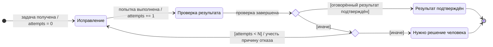

# Учебный пример: ограниченные попытки исправления

Цель — получить исправление, прошедшее оговорённую проверку. Пример описывает
работу в разрешённом учебном проекте. Он не включает commit, push или deploy.

## Пределы

`retry → Work`: `[attempts < N]`. Для этого упражнения преподаватель задаёт
**N = 2**, включая первую попытку. Это учебное значение, не универсальный
рекомендуемый предел. Счётчик начинается с нуля, увеличивается после каждой
попытки и не обнуляется при возврате.

## Work

Изучи причину предыдущего отказа, внеси только разрешённые изменения. Результат
попытки — конкретная дельта и данные, нужные для проверки. При отсутствии
полномочий прекрати действие и обратись к владельцу по правилам проекта.

## Verify

Выполни оговорённую проверку на фактическом результате. В учебном опыте это может
быть воспроизводящий ошибку тест и проверка требуемого поведения. Процесс
предполагает, что средство проверки завершает работу или имеет собственный
таймаут: зависающее средство потребует отдельного состояния ожидания с пределом.

## result и retry

Положительный исход определяется требуемым поведением и фактической проверкой.
Неуспех без доказанного результата идёт к retry. Если попытки остались, в новый
круг передаётся причина отказа; иначе агент заканчивает запуск эскалацией.

## Финалы

- **Done_verified:** результат подтверждён, доступны изменения и свидетельство
  проверки. Это ещё не означает публикацию или развёртывание.
- **Escalate_limit:** сообщи, что требовалось, что проверено, почему результат
  не достигнут и сколько попыток использовано. Назови нужное решение.

## Упражнение

1. Проверь пример командой `python3 scripts/graph_check.py references/example.md`
   из каталога скилла; отрендери Mermaid-блок и сравни изображение с текстом.
2. Удали условие `attempts < N`: checker должен обнаружить неограниченный цикл.
3. Удали fallback у result: checker должен обнаружить неполную развилку.
4. Разбери вручную вариант, где счётчик каждый раз обнуляется: наличие `< N`
   не доказывает завершения, даже если механическая проверка проходит.
5. Для асинхронной проверки добавь отдельное ожидание с общим сроком и финалом
   при истечении. Объясни, почему срок не сбрасывается при повторном входе.

Это проверенное описание и схема упражнения, а не отчёт об автономном запуске
агента в среде слушателя.
