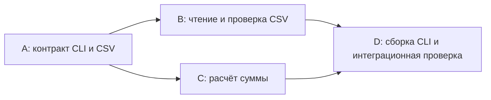
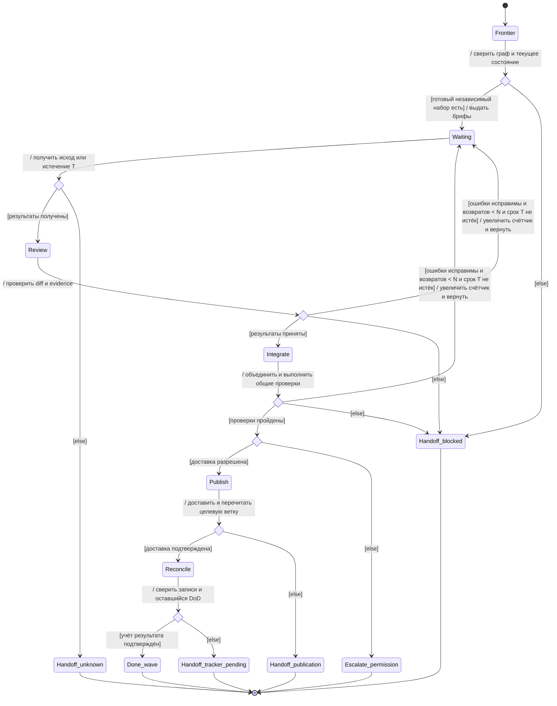

# Пример: небольшой CLI по графу задач

Упражнение дней 2–3 курса: в отдельном учебном проекте создать CLI, который читает
CSV с колонкой `amount` и печатает сумму. Числа десятичные; пустой файл, неверный
заголовок или неверное число дают понятную ошибку и ненулевой exit code.
Не обращайся к реальным финансовым данным и внешним сервисам.
Язык и команды проверок возьми из выбранного учебного проекта.

## Граф зависимостей

| Задача | Результат | Пути | Проверка приёмки |
| --- | --- | --- | --- |
| A | Контракт типов, ошибок и вывода | `docs/csv-cli-contract.md` | Примеры корректного/ошибочного ввода, формат выхода и интерфейсы B/C определены |
| B | Парсер возвращает десятичные значения по A | `src/csv_reader.*`, `tests/test_csv_reader.*` | Верные данные читаются, ошибки заголовка и чисел отвергаются |
| C | Суммирование значений по A | `src/amount_sum.*`, `tests/test_amount_sum.*` | Дроби и отрицательные значения считаются точно, политика пустого ввода соответствует A |
| D | Работающий CLI | `src/cli.*`, `tests/test_cli.*`, `README.md` | Сквозные примеры A проходят с ожидаемыми stdout/stderr и кодами выхода |

Пути с `.*` — описание области примера; после выбора языка зафиксируй точные
имена. Общие manifest/lock-файлы имеет право менять только координатор.
Не копируй ожидания теста из реализации суммирования.

Волна 1: A. Волна 2: B и C параллельно на принятом и доставленном контракте A.
Волна 3: D после доставки B и C. Для B и C нужны отдельные worktree,
хотя файлы не пересекаются. Парсер не может попутно менять контракт A.

## Граф поведения одной волны

`N` и `T` заданы **для упражнения**, а не заимствованы из production:
максимум 2 возврата на доработку для каждой задачи; исходный срок всей её работы
в волне — 15 минут, включая доработки. Это учебные предложения преподавателю;
до реального запуска участник фиксирует применимые значения в записи запуска.
Счётчик увеличивается перед каждым возвратом, срок не перезапускается.
Каждый worker ведёт свой счётчик, при общей ошибке координатор фиксирует,
какая задача возвращена. Достигнутый предел не разрешает пропуск проверки.

`Waiting` имеет ограниченное ожидание до исходного T и возвращает наблюдаемый
исход. При таймауте сохрани handle, файлы и причину, проверь живое состояние,
не запускай дубликат. Завершённый процесс без отчёта требует проверки артефактов.
`Handoff_publication` сохраняет точный исход доставки: подтверждённый отказ или
неизвестный результат. Не называй подтверждённый отказ неизвестным. Повтор возможен
только после диагностики и readback, с прежними ограничениями.

`Escalate_permission` сохраняет готовый diff/PR и точное недостающее разрешение.
`Handoff_tracker_pending` сохраняет проверенный target SHA и ожидаемое обновление
учёта. При возобновлении продолжи следующий незавершённый шаг с теми же N/T,
а не всю волну. Условия завершения и ограничения не меняются при смене сессии.
`Done_wave` завершает только волну: координатор пересчитывает граф и продолжает
поручение. Общий эпик завершён после D и проверки всех его критериев.

## Проверка решений

Это сценарии с ожидаемыми решениями, **не отчёт о выполненном агентном прогоне**.
Преподаватель предлагает один из них без подсказки ожидаемого ответа.

| Входная ситуация | Ожидаемое действие координатора |
| --- | --- |
| B и C зависят только от доставленного A и имеют разные пути/ресурсы | Включить B/C в одну волну в пределах параллелизма |
| B и C хотят править один manifest | Назначить одного владельца manifest или выполнять последовательно |
| В графе A → B → A | Исправить декомпозицию до запуска |
| B сообщает «готово», но нет нужного diff или проверки не проходят | Не принять B и не запускать D, использовать оставшийся бюджет доработки |
| Workers проходят свои тесты, общий тест CLI падает | Исправить интеграцию, не публиковать неуспешный состав |
| Возвраты B исчерпаны, C принят | Сохранить C и blocker B, не объявлять волну завершённой и не запускать D |
| Нужен merge, а разрешены только локальные изменения | Сохранить проверенный состав и конкретный запрос на доставку |
| После push получен таймаут | Прочитать target ref/PR, не повторять push вслепую |
| Сессия прервалась, B ещё работает | Найти исходный handle и writer, не создавать нового B |
| Ответ на вопрос о статусе дан, поручение действует | Вернуться к текущей волне без сброса N/T |
| PR слит, но ожидаемый результат/DoD не проверен | Проверить содержимое и DoD, не закрывать задачу только по PR |
| Все критерии D проверены и результат в default | Сверить полный DoD эпика, завершить только свои ненужные процессы, дать итог |
